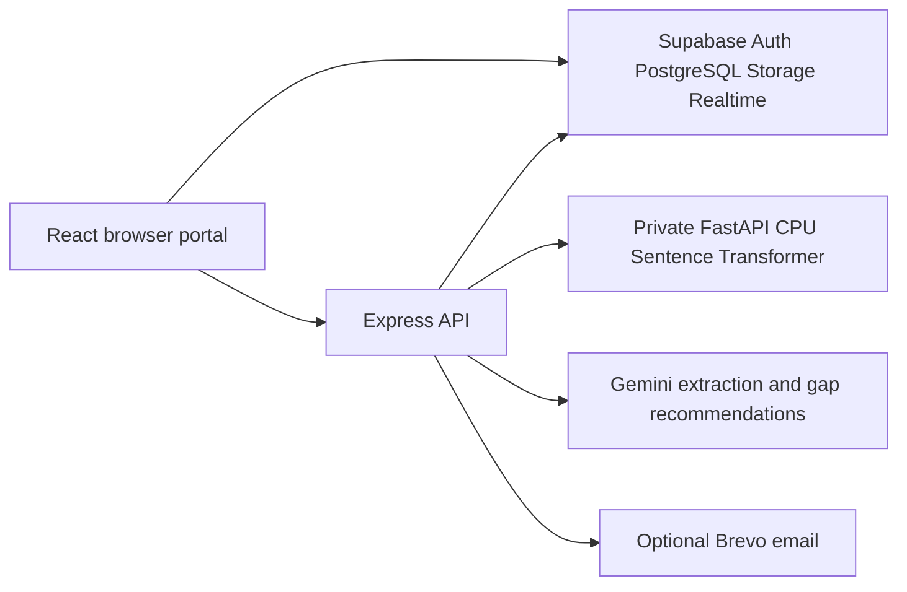

# PESOLUTION V3.1 architecture

## Runtime components

The browser uses the API and Supabase client services under configured policies. Privileged workflow writes and integrations run through Express with server-side credentials and role checks. Express can serve an existing Vite build from dist. Python is a separate process at a private default address; npm start does not launch it.

Actual browser roles are admin and applicant. Public routes include office information, job browsing, contact/legal pages and the resume maker. Staff register applicants, review extracted qualifications, manage jobs/companies, handle referrals/outcomes and review analytics. Applicant routes expose profile, matched jobs and application/referral status. The old feedback route redirects to Analytics; feedback, ratings and sentiment processing are retired.

## Matching pipeline

1. Load confirmed education and latest resume skills, plus eligible active listings.
2. Keep hard/soft channels separate and apply the existing exact/eligible-compound rules.
3. Encode non-exact requirements and eligible phrases using cached pretrained sentence-transformers/all-MiniLM-L6-v2 on CPU. Production normalizes keys, applies limited soft-word hyphen handling, normalizes embeddings and computes cosine. The configured acceptance threshold is currently 0.85.
4. Validate NLP audits in Node before consuming equivalences. Unavailable/invalid service responses expose exact-only fallback.
5. Compute required-skill coverage H and S as percentages and binary ordinal education compliance E. Compatibility is 0.50H + 0.30S + 0.20E. Empty required categories score 100; weights are not renormalized.
6. Retain qualifying matches at the separate 60% cutoff. Vacancies follow Active status, positive/unspecified slots and the existing 30-day posting window.
7. Generate Gemini action/practice/training-topic suggestions for verified gaps. Gemini does not determine cosine equivalence or the weighted score.

Input fingerprints and local evidence caches avoid unnecessary recomputation. Updated qualifications or explicit recalculation can invalidate reuse. Detailed local evidence may disappear on ephemeral-host restart while database match summaries remain. Missing historical cosine evidence is not invented as issuance-time evidence.

## Registration and renewal

Gemini extraction is followed by staff review. Eligible previously hired applicants renew through the existing walk-in form and referral safeguards. Renewal updates reviewed qualifications, preserves the account/prior outcomes and saves before/after snapshots. See [renewal details](applicant-renewal.md).

## Background and session behavior

The shared scheduler coalesces changes and defers hidden/offline views. Fallback polling is 180,000 ms and the focus guard is 30,000 ms; manual refresh remains immediate. The separate session monitor has a 30-minute idle timeout and two-minute warning. Quiet refresh does not disable authentication expiry.

## Implementation references

- [Routes](../src/App.tsx), [API](../backend/app.cjs), [configuration](../backend/config.cjs).
- [NLP](../backend/skill_nlp.py), [audit adapter](../backend/skill-nlp.cjs), [scoring](../backend/domain.cjs), [matching](../backend/matching.cjs), [refresh/cache](../backend/matching-refresh.cjs).
- [Refresh policy](../src/lib/refreshPolicy.ts), [session activity](../src/lib/sessionActivity.ts), [database setup](../supabase/baseline/README.md).

Objective 5 imports the same encoder/cosine utility for component evaluation, without invoking weighted job scoring. See [methodology](nlp-evaluation-methodology.md).
